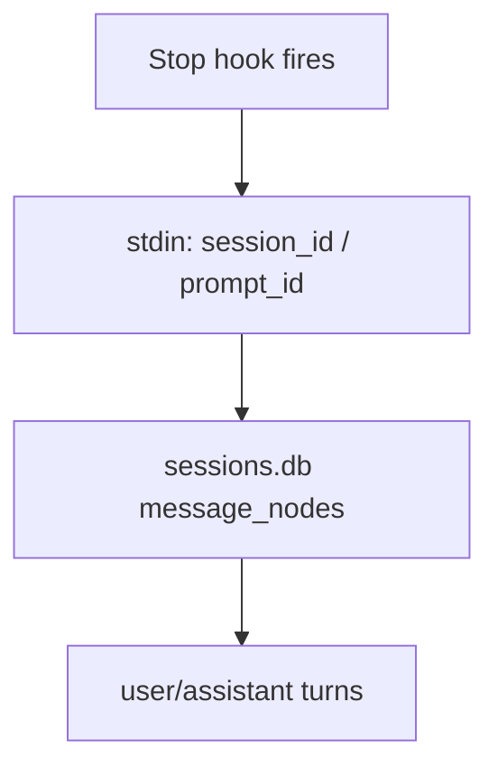

# Devin × OpenViking memory plugin (MVP)

## Problem overview

Today a developer who uses [OpenViking](https://github.com/volcengine/OpenViking) with Cursor, Claude Code, ZCode, or Kimi gets automatic memory: profile on session start, recall on each prompt, durable capture when a turn ends, plus MCP tools. The same person on **local Devin CLI / Desktop** gets none of that. Devin already has plugins, lifecycle hooks, and MCP, but there is no OpenViking host adapter and no product issue on the upstream repo for Devin.

The hard part is not “can Devin load a plugin.” It is **how the end-of-turn capture step reads the conversation**. ZCode and Kimi leave a JSONL transcript/rollout on disk and often pass a path in the hook. Devin’s hook payload has `session_id` / `prompt_id` and **no** `transcript_path`. The live store is SQLite at `~/.local/share/devin/cli/sessions.db`. v1 treats that DB as the single capture source (same “one primary store” pattern as Kimi’s `wire.jsonl`).

## Solution overview

Ship a **community Devin plugin** in this repo (`devin plugins install …`) that reuses OpenViking’s `memory-plugin-shared` behavior via a **pinned vendored copy**, with a thin Devin host adapter for hooks and MCP. Product bar matches ZCode / Kimi: SessionStart profile, UserPromptSubmit recall, Stop capture, MCP + memory skills. Runtime promise for v1 is **local CLI / Desktop only** — not Devin Cloud auto-hooks.

Capture authority stays “full durable conversation text,” not Stop stdin. **v1 reads `sessions.db` only** (no ATIF / `--export` dual path). Ship capture only after fixtures prove decode. Host contract lives in provisional [[DESIGN.md]] and is corrected after a real local session.

Upstream: open an OpenViking feature issue before a large PR; later add a thin `hosts/devin` (or docs link) once the community plugin works.

```mermaid diff [What the user gets on local Devin]
 flowchart LR
-    U[Developer] -->|chat| D[Devin CLI]
-    D --> Void[No OpenViking memory]
+    U[Developer] -->|chat| D[Devin CLI]
+    D -->|hooks + MCP| P[openviking-devin-memory plugin]
+    P -->|recall / capture / tools| OV[OpenViking server]
     %% ref node:D [[README.md]]
```

## Goals

- Installable Devin plugin with the same *class* of automatic memory as community ZCode / Kimi.
- Fail-open hooks; do not break Devin if OpenViking is down.
- Pin Devin CLI version and document the host contract in `DESIGN.md` before locking capture claims.
- Vendor `memory-plugin-shared` at a known revision (independent public repo; no OV installer assemble path).

## Non-goals (v1)

- Devin Cloud session auto-hooks / parity with local.
- Treating Stop stdin JSON as the full transcript.
- Waiting on upstream reply before coding (issue first, then implement).
- Installer/doctor polish beyond what MVP needs to run.
- Droid host work in this repo.

## Locked decisions (2026-10-30)

| Topic | Decision |
| --- | --- |
| Packaging | `.devin-plugin` + hooks + `.mcp.json` + skills |
| Capability bar | Start · Prompt recall · Stop capture · MCP |
| Runtime | Local CLI / Desktop only |
| Shared library | Pin and vendor `memory-plugin-shared` into this repo |
| Capture authority | Durable full session text; stdin is trigger/metadata |
| Capture source | `sessions.db` only; fixtures required; ATIF / `--export` out of v1 |
| Host contract doc | Provisional [[DESIGN.md]]; revise after measured fixture |
| Upstream cadence | Open OV issue, then code; PR `hosts/devin` after MVP works |

---

### Phase 1: Host contract and one real session fixture

**Today**

README records research guesses. The local `sessions.db` schema is readable (`message_nodes.chat_message` JSON with `role` / `content`), but the developer’s DB had **zero** session rows and an empty `cli/transcripts/` directory, so nobody has proven “decoded text = what was on screen.” `--export` is documented by Devin but not fixture-tested here.

**Proposed**

Pin a Devin CLI version. Run one short **local** chat so the repo can keep anonymized fixtures: hook stdin samples and a `sessions.db` slice. Revise [[DESIGN.md]] with measured hook fields and decode rules. Capture code stays out of this phase; this phase only removes guesswork.



```changes

```

### Phase 2: Plugin scaffold and vendored shared runtime

**Today**

The repo is a scaffold: [[README.md]] and [[.gitignore]] only. There is no installable plugin tree.

**Proposed**

Add the Devin plugin layout (`.devin-plugin/plugin.json`, `hooks.json`, `.mcp.json`, skills stubs) and a pinned copy of `memory-plugin-shared` under a clear vendor path. Devin-specific glue stays in a small host adapter; shared recall/capture/HTTP/MCP stay in the vendored tree. Document Node version and “do not edit vendor; bump pin instead” in a thin public `AGENTS.md`.

```changes

```

### Phase 3: SessionStart profile and UserPromptSubmit recall

**Today**

Opening or prompting Devin never injects OpenViking profile or recall context.

**Proposed**

On `SessionStart`, the plugin injects one OpenViking context block (profile, available memories/skills) the same way other hosts do. On `UserPromptSubmit`, it runs recall against the prompt and injects results. Workspace resolution uses `DEVIN_PROJECT_DIR` (and peers rules from shared config), not a missing `cwd` field on stdin.

From the developer’s side: after `devin plugins install` and a working OpenViking server, a new local session should already “know” durable preferences without pasting them by hand.

```callstack
 out = onSessionStart(hookInput)
 ├── cfg = loadPluginConfig()
 ├── block = buildProfileContext(cfg)
 └── return inject(block)

 out = onUserPromptSubmit(hookInput)
 ├── cfg = loadPluginConfig()
 ├── hits = recall(prompt, cfg)
 └── return inject(hits)
```

```changes

```

### Phase 4: OpenViking MCP proxy and memory skills

**Today**

Devin can attach MCP servers, but this project does not yet ship an OpenViking MCP proxy or the companion memory skills.

**Proposed**

Ship `.mcp.json` that points at a stdio (or HTTP) proxy wrapping OpenViking’s memory/skills APIs, plus the same skill pack shape other community hosts use (`openviking-memory`, skills search, experience memory as needed). Fail-open if the server is unreachable.

```changes

```

### Phase 5: Stop capture from `sessions.db`

**Today**

Nothing writes the Devin conversation into OpenViking when a turn ends. Claiming capture without fixtures would lie.

**Proposed**

On `Stop` (and compact/end events once DESIGN confirms names), read `message_nodes` for `session_id` from `sessions.db`, decode incremental user/assistant turns, then filter and commit through the shared capture pipeline (`addAgentMessages` / `commitAgentSession`).

Ship only after Phase 1 fixtures round-trip: fixture in → turns out → match expected messages.

```callstack
 result = onStop(hookInput)
 ├── meta = readSessionMeta(stdin)
 ├── turns = readSessionsDbTurns(sessionId)
 ├── if unreadable: return skip fail-open
 ├── filtered = filterCapture(turns)
 └── return commitToOpenViking(filtered)
```

```changes

```

### Phase 6: Open OpenViking feature issue

**Today**

No product-related Devin issue/PR on `volcengine/OpenViking` (as of 2026-10-30 research).

**Proposed**

Open a bilingual feature issue that describes the community adapter, host contract summary, capture caveat, and intent to contribute `hosts/devin` (or a docs link) after MVP verification. Coding does not wait on a reply. A later phase (out of this MVP commit chain) lands the upstream PR.

```changes

```

## References

- [[README.md]] — public status, host findings, MVP list
- [[DESIGN.md]] — provisional Devin host contract (revise after fixture)
- OpenViking community hosts (upstream): ZCode rollout JSONL, Kimi `wire.jsonl`, Cursor `transcript_path`
- Local observed store: `~/.local/share/devin/cli/sessions.db` (2026-10-30 empty of rows)
- Reviewers noted for later upstream: `@t0saki`, `@ZaynJarvis`
